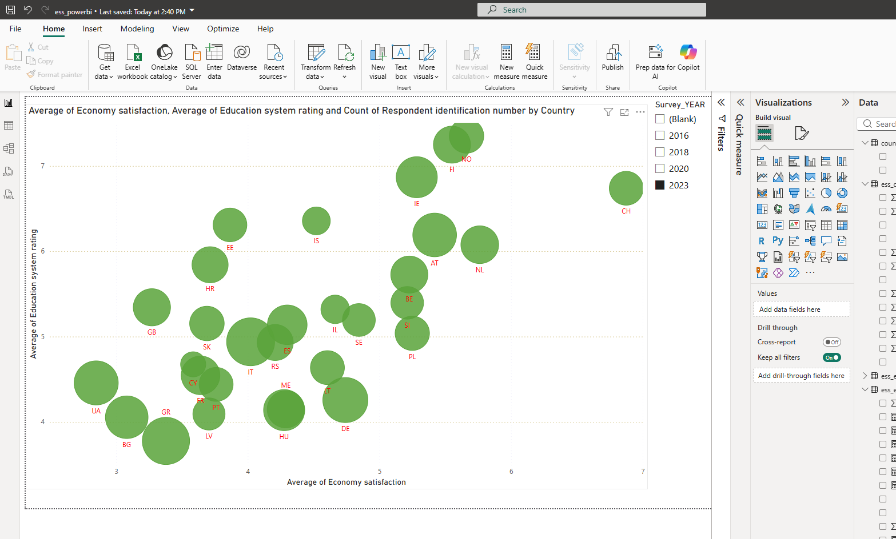

# Economic wellbeing in Europe | SQL Server and Power BI

How many respondents struggle to live on their household income? Do countries that rate their economy highly also rate their education system highly? This report explores those questions across four rounds of the European Social Survey (ESS), with **181,633 survey responses from 34 countries** across the four rounds.

**Open the interactive report.** Download the file using GitHub’s **Download raw file** button, then open it in Power BI Desktop. The saved report includes its imported data. Start on **Economy and Education**, select **2023**, and hover over a country. The two averages give its position and the response count determines the bubble size. [Power BI report](report/ess_powerbi.pbix)



## Results from round 11 (2023)

**Difficulty living on household income.** Among respondents who answered the income question, 68.2% in Ukraine, 47.9% in Bulgaria, 27.5% in Hungary and 5.0% in Sweden chose *difficult* or *very difficult*. The denominator changes with the country and survey wave.

| Country | Difficult or very difficult | Valid answers | Share |
| --- | ---: | ---: | ---: |
| Ukraine | 1,772 | 2,598 | 68.2% |
| Bulgaria | 1,067 | 2,229 | 47.9% |
| Hungary | 577 | 2,096 | 27.5% |
| Sweden | 61 | 1,222 | 5.0% |

**Economy and education ratings can diverge.** Norwegian respondents rated education **7.35/10** on average and economic satisfaction **5.66/10**. In Switzerland the corresponding averages were **6.74** and **6.88**. These chart points use 1,312 and 1,264 responses respectively. The Power Query step for this visual keeps respondents who answered all three questions about the economy, education and health services.

These are **unweighted sample results**. Each valid response has equal weight. Countries participated in different rounds, and some report pages use restricted samples. Compare countries within a selected round and check response counts when interpreting differences.

## 1. Prepare and check the data in SQL Server

1. **Import the four waves.** The project selected a common set of columns from the four integrated files and loaded one SQL Server table per round. The year in the report labels the ESS wave. Fieldwork dates can vary by country.

   | ESS round | Report year | Input table | Rows loaded | Countries |
   | ---: | ---: | --- | ---: | ---: |
   | 8 | 2016 | `ess16` | 44,387 | 23 |
   | 9 | 2018 | `ess18` | 49,519 | 29 |
   | 10 | 2020 | `ess20` | 37,611 | 22 |
   | 11 | 2023 | `ess23` | 50,116 | 30 |

2. **Check the respondent key.** Count the rows in each input table. Group by `essround, cntry, idno` and check for counts above one. The combined data contained **zero duplicate round–country–ID combinations**. An ID can recur in another country or round.
3. **Append the waves.** `UNION ALL` stacks the four inputs in `ess_all_waves`. Split the combined table into geography, demographics, employment, income, wellbeing and public assessments, retaining the three key columns in each.
4. **Recode missing responses by question.** Six `_rec` views use `CASE` to convert selected ESS special codes to SQL `NULL`. For example, `hincfel` uses 7, 8 and 9 for nonresponse, while the satisfaction questions use 77, 88 and 99. A zero on a 0–10 rating scale is a valid answer.
5. **Join and aggregate at the intended level.** Join on all three key columns for respondent-level analysis. The analytical views combine income with region, summarise wellbeing by income category and country, and summarise public assessments by partner’s education (`eiscedp`). A separate combined demographics, employment and wellbeing view restricts the sample to ages **25–65 inclusive**, with recorded gender and health, at least one of the two selected employment fields, and happiness or life satisfaction. This restriction matters for the wellbeing trend and its coverage counts.

The SQL file contains the input checks, thematic tables, cleaning rules and analytical views in execution order. [SQL workflow](./--%20ESS_SQL_v1.sql)

## 2. Build the Power BI report

1. **Connect Power Query to the SQL views.** Import the cleaned topic views and the combined wellbeing view from `ESS_EconomicWellbeing`. Rename fields for readers, including `stfeco` → *Economy satisfaction*, `stfedu` → *Education system rating* and `hincfel` → *Perceived household financial situation*.
2. **Create categories for charts.** Group ages into 15–24, 25–34, 35–44, 45–54, 55–64 and 65+. Group economy and education scores into low (0–3), moderate (4–6) and high (7–10). These rating bands are choices made for this report. Give each set of labels its own numeric sort column so it displays in order.
3. **Build the relationships.** Deduplicate country codes and survey rounds to make lookup tables for the slicers. Use the shared country and round fields to filter the topic tables. To compare age with public assessments, build a `round|country|id` text key in demographics and public assessments and connect the tables one-to-one. Keep a separate map label for Slovakia while retaining `SK` as the country key.
4. **Define the measures.** Calculate counts of valid responses, average and median wellbeing scores, and the share reporting income difficulty. The income measure codes answers 3–4 as one, 1–2 as zero and other answers as blank. Averaging those values gives the share within the selected country and wave.

   ```dax
   Income difficulty % =
   AVERAGEX(
       'ess_inc_rec',
       SWITCH(
           'ess_inc_rec'[Perceived household financial situation],
           1, 0,
           2, 0,
           3, 1,
           4, 1,
           BLANK()
       )
   )
   ```

5. **Build and check the visuals.** The report has ten pages. Coverage matrices show which country–wave combinations have valid happiness and life satisfaction responses. The demographic chart shows age composition by gender. The stacked charts compare the mix of economy and education ratings across age groups. A separate pie chart shows the economy rating bands for a selected country and wave. Other pages show average happiness over time, a life satisfaction map, the economy–education bubble chart, and separate income-difficulty ranking and trend pages. Cross-check the report’s percentages against the SQL counts above using the same country, wave and valid-answer criteria.

## Reproduce a result

Run this query against the cleaned income view. For Hungary in round 11 it returns 577 responses reporting difficulty out of 2,096 valid answers.

```sql
SELECT
    cntry,
    COUNT(*) AS valid_answers,
    SUM(CASE WHEN hincfel IN (3, 4) THEN 1 ELSE 0 END) AS difficulty_answers,
    CAST(100.0 * SUM(CASE WHEN hincfel IN (3, 4) THEN 1 ELSE 0 END)
         / COUNT(*) AS decimal(5, 1)) AS difficulty_pct
FROM dbo.ess_income_rec
WHERE essround = 11 AND hincfel IN (1, 2, 3, 4)
GROUP BY cntry
ORDER BY difficulty_pct DESC;
```

**To rebuild or refresh.** Open a fresh SQL Server database named `ESS_EconomicWellbeing`. Load the four input tables with the same selected fields, compatible types and column order before running the SQL file in SSMS. The script creates its output tables and views. In Power BI Desktop, use **Transform data → Data source settings → Change Source** to point the report to your own SQL Server, then **Refresh**.

<details>
<summary>Input fields in their import order</summary>

```text
name, essround, edition, proddate, idno, cntry, region, regunit, domicil,
agea, gndr, hhmmb, maritalb, eduyrs, eiscedp, mainact, emplrel, wrkctra,
wkhtot, uemp3m, uemp12m, uemp5yr, hincsrca, hinctnta, hincfel, happy,
health, hlthhmp, sclmeet, inprdsc, sclact, stflife, stfeco, stfgov,
stfdem, stfedu, stfhlth
```

</details>

**Known field issues.** In the original round 10 import, employment contract type (`wrkctra`) was copied into the working-hours position (`wkhtot`). Use the original ESS `wkhtot` field when rebuilding the inputs. In the report’s `ess_wb_rec` table, `hlthhmp` (activity limitations due to health) carries the display label *Household size*. For household size, use `hhmmb` in demographics. The results presented above use income and public-assessment fields.

## Data and attribution

European Social Survey European Research Infrastructure (ESS ERIC). The integrated files are distributed by Sikt, the Norwegian Agency for Shared Services in Education and Research. The report uses a selection of fields, recodes responses and presents derived summaries. Sikt’s distribution records identify the source data licence as Creative Commons Attribution 4.0 International. [Data licence](https://creativecommons.org/licenses/by/4.0/)

- ESS round 8, edition 2.3 (2023). [Dataset and citation](https://doi.org/10.21338/ess8e02_3)
- ESS round 9, edition 3.3 (2026). [Dataset and citation](https://doi.org/10.21338/ess9e03_3)
- ESS round 10, edition 3.3 (2025). [Dataset and citation](https://doi.org/10.21338/ess10e03_3)
- ESS round 11, edition 4.2 (2026). [Dataset and citation](https://doi.org/10.21338/ess11e04_2)
